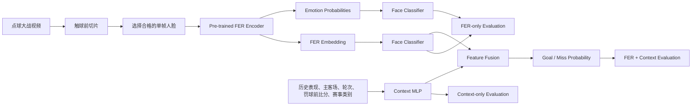

# Course Project Plan

## 0. 当前进度（2026-11-11 更新）

> 本节记录实际执行状态，以及与原计划的偏离。下文第 1–24 节保留原始设计；有改动的地方用带日期的"修订"引用块标注。当前全部结论数字以 `results/reports/summary_5fold_20261104.md` 为准。

### 0.1 阶段状态

| 阶段 | 状态 | 说明 |
|---|---|---|
| Phase 0 标注规范 | 完成 | 触球时刻双打点（marker.py）、人工截帧（capture_face.py）、history 3 季口径、排除日志 |
| Phase 1 Pilot | 完成 | 14 场世界杯（计划 20 场），123 次罚球 / 114 个有效人脸 |
| Phase 2 扩展 | **完成，停在 40 场** | 网上能找到的可用比赛基本收齐，40 场即最终规模（见 §6.1 修订） |
| Phase 3 单分支基线 | 完成 | B0–B4、M1 |
| Phase 4 融合与微调 | **完成** | M3 完成（阴性）；M2 完成（2026-11-06，阴性：微调无收益、只训头即等同）；M4 完成（2026-11-09，阴性：融合不产生增量、稳定低于 context-only） |
| Phase 5 正式评估与消融 | **完成** | 5 折 match-disjoint + 10 组重复划分 + 置换检验完成；A1、A2、A4、A5、A6、A7 有结果；A8 经 2026-11-11 评估后**决定不执行**（见 §0.4 第 8 条） |
| Phase 6 写作 | 未开始 | |

### 0.2 最终数据

- 40 场点球大战，2006–2026 年，全部为 360p 转播；
- 412 次罚球，其中 385 个有效样本（goal 278 / miss 107，miss 率 27.8%），27 个因 `no_face` 排除；
- 赛事按 §6.6.5 映射：国际国家队赛事 21 场（世界杯 14、欧洲杯 6、欧国联 1），洲际俱乐部赛事 11 场（欧冠 8、欧联 1、欧协联 1、欧超杯 1），国内杯赛 8 场（足总杯 5、社区盾 3）。

### 0.3 假设检验现状（重复划分，pooled_rank，200 次全流程置换）

| 假设 | 对应比较 | 结果 | 判定 |
|---|---|---|---|
| H1 FER 有信号 | M1 vs 零分布 | 0.467，p=0.82 | 不支持 |
| H2 embedding 优于情绪概率 | M1 vs B3 | M1 0.467，B3 0.485–0.526，两者都无信号 | 不支持 |
| H3 FER 预训练优于 ImageNet | M1 − B4 | +0.003，6/10 seed，p=0.48 | 不支持 |
| H4 部分微调有效 | M2 vs M1 | M2 0.488 vs M1 0.467；检验 seed 配对 Δ +0.010（p_Δ=0.475）；只训头对照 0.485 与 M2 差 0.003 | 不支持（layer4 适配无贡献） |
| H5 Context 有效 | B1v2 / B2v2 vs 零分布 | B1v2 0.553，p=0.060；B2v2 0.495，p=0.58 | 未达显著（B1v2 接近阈值） |
| H6 FER 增量价值 | M3v2 − B1v2 | −0.086，0/10 seed | 不支持（融合一致更差） |
| H7 随机划分高估 | random vs match-disjoint | Δ −0.010 ~ −0.003，全部 p_Δ≥0.57 | 不支持（0/4 臂；方向与预期相反） |
| H8 微调+融合有增量 | M4_lr − B1v2 / M4_mlp − B2v2 | M4_lr 0.505 vs B1v2 0.553（Δ −0.048，0/10 seed），p_Δ=0.881；M4_mlp 0.491 vs B2v2 0.495，p_Δ=0.297 | 不支持（融合稳定低于 context-only） |
| H9 图像质量限制 FER | M1 在高质量子集 vs 置换零分布 与 随机等量子集分布 | 子集 333 样本：M1 0.449；H9a p=0.935（零分布 p95 0.570）；H9b 7.5%（ctrl 0.459）；两口径一致 | 不支持（且 B1v2 同步 −0.011 = −3.5 sd，子集构成主导） |

检测下限：零分布 p95 在 0.55–0.57，即在 385 样本下，pooled_rank 低于约 0.55 的效应测不出来。

> **2026-11-04 勘误（MLP init）**：`train_one_fold` 只在内部 `manual_seed`，那已在模型构造之后，
> MLP 臂初始权重取自进程全局 RNG，逐位不可复现（实测同 seed 跨进程摆动到 |Δ| 0.08）。
> 已在 `run_baselines.seeded_model` / `eval_repeated_splits` 补种并重跑受影响的输出。
> **仅 MLP 臂（B2v2、context_mlp 系列）数字变动**，全部 LR 臂逐位不变。新旧报告都保留，
> 带 `determinism.mlp_init_seeded = true` 的才可复现。详见 results/reports/summary_5fold_20261104.md 顶部。

### 0.4 与原计划的偏离

1. **数据规模**：40 场，原计划 60–80 场（§6.1）。
2. **划分协议**：先用 40 折 LOMO，因单场 val 无法选超参而作废；现为 5 折 + 内层 val，每折 test 7–9 场，原计划 12–16 场（§10.2）。
3. **Context 特征**：主客场与赛事类别两类不编码（§6.6.2 / §6.6.5）—— **2026-11-04 经用户决定，不补标、不映射，论文中记为偏离**（表 4 两行标 `not modeled`）；轮次/比分改用 v2 六维编码。
4. **主统计量**：在 AUROC 的基础上，以 pooled_rank 与置换零分布为主要判读口径（§11）。
5. **超出计划的探索**：backbone 对比（§19 Could Have）、VA-MTL 连续情绪头、多帧聚合（§19 明确不实现）。多帧只作探索性诊断，不进主结果。
6. **A7 子集口径**（2026-11-10）：plan §0.5 原写"样本级 ≥80px → 375/385"，因实测质量**按比赛聚簇**（样本级剔除会改变 m004 场的内部构成），用户 2026-11-10 改为**场级完整**口径 → **35 场 / 333 样本**。
7. **A7 追加对照**（2026-11-10）：plan §12 A7 原文没有随机等量子集对照，经用户确认追加 **A7-ctrl**（随机抽 333 样本 × 200 次）作为 H9b 的判读基础；理由见 summary §4.6 第 5 条——本样本量下任何按比赛剔除子集的做法都会让 context 侧弱信号漂移超出逐场噪声（−3.5 sd），无此对照则无法区分"子集构成"与"被检验的因素"。
8. **A8 不执行**（2026-11-11，经用户决定）：A8（严格 crop vs 宽头部区域 crop）是**归因类实验**——拆解"已有信号来自表情还是场景线索"。但主表结论是 M1 无信号（0.467，p=0.821），M2/M3/M4/A7 全部阴性，**没有可归因的信号对象**：宽 ≈ 严格只给阴性结果加一条次要稳健性；宽 ≠ 严格也不改变主结论（场景线索同样未产生信号）。已做的可行性侦察还发现其成本偏高：`face_frames.csv` 只覆盖 340/385，45 个样本需模板匹配找回源帧，3 个样本（m001-k03 / m001-k08 / m004-k06）为 YuNet 检出失败后的人工裁剪、无检测框可外扩。审稿层面的"是否场景线索"质疑已由 B4 ImageNet 同骨干对照（0.464 vs 0.467，p=0.483）+ A7 + 检测下限披露覆盖。A8 移入 §19 Could Have，论文中记为偏离，**不得**写成"已排除场景线索依赖"。

### 0.5 下一步

1. A5 的 `minus_history` 复核：它是全项目唯一过 p<0.05 的臂（0.563，p=0.020），但属于看过结果后
   从 7 个变体中挑出，须独立预注册 + 新 seed 集合才能作为结论（summary §3）；
2. player 跨折重复统计（§10.4，需要补回球员标识）；
3. 写作（Phase 6）：`proposal/proposal.tex` 仍是 pilot 版本，须按 40 场定稿更新。

> **2026-11-11：A8 决定不执行**（用户决定，理由见 §0.4 第 8 条：归因类实验以存在可归因
> 信号为前提，主表全阴性使其不具信息量；且 48/385 样本需另建源帧找回流程，成本偏高）。
> 原定"A8 须带 A7-ctrl 式随机等量子集对照"的要求随实验取消一并作废；该通用警示仍适用于
> 任何未来新增的子集类实验。Phase 5 至此收尾，实验性工作全部结束，进入 Phase 6。

> **2026-11-10：A7 完成（H9 不支持）。** 详见 summary §4.6 / §12 A7。
> 场级完整 ≥80px → 35 场 / 333 样本；M1 0.449 ± 0.031；H9a p=0.935（零分布 p95 0.570）；
> H9b 落随机子集分布 7.5% 百分位（ctrl 0.459 ± 0.024）；crop 短边与 face_w_px 两口径一致。
> **方法学对照 B1v2 同步下降 −0.011（−3.5 sd，已排除单场主导）** —— 子集构成本身主导，
> A7 无法干净归因于画质。子集零分布 p95 升至 0.570–0.577，检测下限比全量更差，
> 故只能写"未检出"而非"证否"。

> **2026-11-09：M4 完成，Phase 4 收尾。** 详见 summary §4.5 / §12 A4。
> 臂：M4_lr（微调 FER 支 + B1v2 口径 context 支）/ M4_mlp（+ B2v2 口径 context 支），
> 两支先训好再冻结，融合层为 3 参数 logit 加权，在**内层 val** 上拟合（对 §7.4 投影+拼接的偏离，
> 理由与披露见 `results/reports/m4_fusion_criteria_preregistered.txt` 第 1 节）。
> - 前置断言：B1v2/B2v2/M1 三个哨兵臂 × 10 seed = 30 条，最大 |Δ| = 5.6e-17；本脚本 M2 逐位复现。
> - M4_lr 0.505±0.022｜M4_mlp 0.491±0.024｜M2 0.488±0.024（参照 B1v2 0.553 / B2v2 0.495）。
> - **H8a（M4_lr − B1v2）：Δ −0.048、0/10 seed 为正，检验 seed 上 −0.068，p_Δ=0.881 → 否。**
>   **H8b（M4_mlp − B2v2）：Δ −0.004、4/10，p_Δ=0.297 → 否。H8 不支持。**
> - 两变体差异（M4_lr − M4_mlp 点估计 +0.014，p_Δ=0.545 不可区分）应归给**基座强度**
>   （B1v2 0.553 vs B2v2 0.495），不是融合器对不同基座的处理不同。
> - **机制发现（否定"用 w_f≈0 证明 FER 无信号"的思路）**：只把融合层从 val 换到 train 拟合，
>   `w_fer` 从 +0.067±0.225（9/10 seed 为正）变成 +0.914±0.614（10/10），翻 13 倍、符号变齐，
>   而 pooled_rank 几乎不变（p_Δ=0.198）。因 val 每折仅 40–74 例，3 参数在噪声上拟合。
>   → `w` 的绝对值在重标定下不可识别，**不得**用 `w_f≈0` 写成"证明表情无信号"，
>   也不得用 `w_f`=0.91 写成"表情有强信号"；只能写"3 参数融合下 `w` 不可辨识"，
>   判定回到增量检验。这在 n=385 下是结构性的，不是设计缺陷。

---

## 1. 暂定题目

### 推荐题目

**Can Pre-trained Facial Expression Representations Predict Penalty Shootout Outcomes?**  
**预训练面部表情表征能否预测点球大战结果？**

### 完整题目

**Evaluating Facial Expression and Match Context for Penalty Shootout Outcome Prediction**

中文：

**面部表情与比赛上下文对点球大战结果的预测研究**

---

## 2. 项目概述（Project Overview）

本项目研究球员在点球大战主罚前的面部视觉信息，能否在历史点球表现和比赛上下文之外，为本次罚球结果提供额外的预测信号。

项目只收集点球大战（penalty shootout）中的罚球，不考虑常规时间或加时赛中的单次点球。对于每次罚球，只使用触球前的画面，从中选择一张质量合格的主罚球员面部图像。

项目不实现多帧时序模型或 GRU，而是建立两条独立分支：

1. **FER 分支**：使用预训练 Facial Expression Recognition（FER）模型提取面部表征；
2. **Context 分支**：使用 MLP 编码历史点球表现、主客场、点球大战轮次、罚球前比分和赛事类别。

最后融合两条分支，预测该次罚球是 `Goal` 还是 `Miss`。

项目重点不是声称模型能够读取球员真实心理状态，而是通过严格对照实验回答：预训练 FER 表征是否具有预测价值，以及它是否能在 context-only 模型基础上带来额外收益。

---

## 3. 研究范围（Scope）

### 包含内容

- 点球大战中的罚球事件；
- 每次罚球触球前的单帧面部图像；
- 预训练 FER encoder 的情绪概率与中间层 embedding；
- 基于五类上下文变量的 Context MLP；
- FER-only、Context-only 和 FER+Context 三类模型；
- 冻结 FER 与部分微调 FER 的比较；
- 以比赛为分组单位的跨比赛评估；
- 面部质量、身份信息和数据泄漏分析。

### 不包含内容

- 常规时间或加时赛中的单次点球；
- 罚球后的表情、射门动作或守门员反应；
- 多帧视频建模；
- GRU、LSTM 或 Temporal Transformer；
- 将 FER 输出解释为球员真实心理状态；
- 使用本次罚球结果发生后才能获得的信息。

---

## 4. 研究问题（Research Questions）

### RQ1：FER 表征是否具有预测能力？

主罚前单帧面部图像的 FER 表征是否能够预测本次点球结果？

### RQ2：哪种 FER 输出更有效？

FER encoder 的中间层 embedding 是否比最终的基本情绪概率提供更多预测信息？

### RQ3：FER 预训练是否具有特殊价值？

在相同下游分类器设置下，FER-pretrained encoder 是否优于普通 ImageNet-pretrained encoder？

### RQ4：部分微调是否有效？

在当前数据规模下，部分微调 FER encoder 是否优于完全冻结 encoder？

### RQ5：Context 能够解释多少预测信息？

仅使用历史点球表现、主客场、点球大战轮次、罚球前比分和赛事类别时，Context MLP 能达到怎样的预测性能？

### RQ6：FER 是否具有增量价值？

融合 FER 和 context 后，是否能够稳定优于 Context-only 模型？

### RQ7：模型能否跨比赛泛化？

当测试集由训练阶段未见过的完整点球大战组成时，模型是否仍然有效？

---

## 5. 可证伪假设（Falsifiable Hypotheses）

### H1：FER 表征包含点球结果相关信号

FER-only 模型在 AUROC、AUPRC 或 Brier score 上优于多数类基线。

**反证条件：**如果 FER-only 模型在 match-disjoint 测试中不优于简单基线，则没有足够证据支持面部表征具有稳定预测价值。

### H2：FER embedding 优于情绪概率

FER 中间层 embedding 比最终的基本情绪概率向量具有更好的预测性能。

**反证条件：**如果两者表现相当，则高维 embedding 没有显示额外价值；如果两者都无效，则通用 FER 表征可能不适合该场景。

### H3：FER 预训练优于普通视觉预训练

在骨干网络规模和下游分类器尽量一致时，FER-pretrained encoder 优于 ImageNet-pretrained encoder。

**反证条件：**如果 ImageNet encoder 表现相当或更好，则不能将模型效果归因于表情识别预训练。

### H4：部分微调能够改善领域适配

只解冻 FER encoder 的最后一个 block，并使用较小学习率微调，能够优于完全冻结 encoder。

**反证条件：**如果部分微调没有提升 match-disjoint 测试性能，或只提升训练性能，则微调可能造成过拟合。

### H5：Context MLP 具有有效基线性能

五类上下文变量能够提供高于多数类基线的预测能力。

**反证条件：**如果 Context-only 模型不优于基线，则当前上下文变量或样本规模不足以解释结果差异。

### H6：FER 具有增量预测价值

FER+Context 模型在相同测试集上优于 Context-only 模型。

**反证条件：**如果融合后没有稳定改善，则面部信息没有显示超出已知上下文的增量价值。

### H7：随机事件划分会高估性能

Random event split 的表现高于 match-disjoint split，因为随机划分可能共享同场比赛的转播风格、背景和相关球员。

**反证条件：**如果两种划分的表现接近，则比赛级信息共享对当前模型影响有限。

---

## 6. 数据计划（Dataset Plan）

### 6.1 两阶段数据建设

#### 阶段一：20 场 Pipeline 可行性验证

首先收集约 20 场完整点球大战。该阶段的目的不是直接形成最终数据集或给出最终模型结论，而是验证整套 pipeline 是否可行，包括：

- 视频能否稳定获得；
- 点球事件能否高效切片；
- 触球前是否经常出现清晰的主罚球员面部；
- 人脸检测、确认和裁剪是否可靠；
- FER 模型能否处理足球转播画面；
- 五类 context 信息能否完整、无泄漏地获得；
- 每场比赛的人工处理时间是否可接受；
- Goal/Miss 比例和有效样本率是否支持后续建模。

一场点球大战通常包含约 8–12 次或更多罚球，因此 20 场预计提供约 160–240 个原始罚球事件。经过面部质量筛选后，有效样本数会更少。该阶段主要用于估计有效样本率和处理成本，不应仅凭 20 场数据作强结论。

#### 阶段二：扩展至 60–80 场正式数据集

如果 20 场验证表明 pipeline 可行，计划扩展到约 60–80 场点球大战。

粗略预期：

- 原始罚球事件约 480–960 个；
- 最终有效样本数由阶段一测得的人脸可用率决定；
- 比赛数量增加后，可以进行更可靠的 match-disjoint cross-validation；
- 数据允许时，可以额外进行 player-disjoint 或跨赛事泛化分析。

最终样本量必须根据实际数据统计报告，不能只报告计划场次数量。

> **2026-11-04 修订（规模定稿）**：阶段一实际为 14 场世界杯（剔除 2000 年前画质过差的比赛，17→14），
> 123 次罚球 / 114 个有效人脸；matches.csv 记录的单场处理时间约 3 分钟（只有这 14 场有记录）。阶段二扩展到 40 场后，网上可获得的
> 可用点球大战视频已基本收齐，**40 场为最终规模**（412 次罚球 / 385 有效 / 107 个 miss）。
> 这属于 §23 第 2 条"在可行的前提下扩展"的不可行情形，论文中按实际规模报告并作为局限披露。

### 6.2 Pipeline 可行性指标

20 场验证阶段需要记录以下指标：

| 指标 | 目的 |
|---|---|
| 原始罚球事件数 | 估算每场平均样本量 |
| 有触球前面部画面的比例 | 判断研究输入是否普遍存在 |
| 通过质量筛选的比例 | 估算最终有效样本量 |
| Goal/Miss 数量及比例 | 判断类别不平衡程度 |
| 自动人脸检测成功率 | 评估自动化程度 |
| 人工修正比例 | 估算标注工作量 |
| 单场平均处理时间 | 估算扩展至 60–80 场的成本 |
| Context 字段缺失率 | 判断 Context MLP 是否可行 |
| FER 输出分布 | 检查是否几乎全部预测为 neutral |

建议在 20 场验证后设置明确的继续条件：

- 有效人脸比例足以支持扩大数据；
- 预计扩展后的 Miss 样本数量足以评估模型；
- 每场人工成本在项目时间预算内；
- 历史表现与比赛 context 能够可靠获取；
- 不存在系统性的结果泄漏。

### 6.3 样本定义

每个样本对应点球大战中的一次罚球，包含：

- 一段在触球前结束的视频切片；
- 从切片中选择的一张主罚球员面部图像；
- 点球结果标签；
- 五类 context 特征；
- 比赛、球员和赛事标识；
- 人脸质量信息。

### 6.4 结果标签

- `1 = Goal`：进球；
- `0 = Miss`：未进球，包括被扑出、射偏和击中门框。

可以额外记录 `saved`、`off_target` 和 `woodwork`，但主要任务保持二分类。

### 6.5 面部帧选择规则

对每次罚球，从触球前切片中选择**最接近触球时刻且质量合格的一张主罚球员面部图像**。

选择规则必须在查看模型结果前固定：

1. 图像必须出现在触球前；
2. 人脸检测置信度高于预设阈值；
3. 人脸达到最低像素尺寸；
4. 眼眉和嘴部没有严重遮挡；
5. 若最后一帧质量不合格，则按时间向前寻找最近的合格帧；
6. 若整个切片没有合格面部帧，则丢弃该样本并记录原因。

禁止使用罚球后的表情，因为它会直接泄漏点球结果。

### 6.6 Context 特征

Context 分支只包含以下五类信息。

#### 1. 历史点球表现（Historical Penalty Performance）

使用该球员在本次罚球发生前的历史记录：

- 历史罚球次数；
- 历史进球次数；
- 历史成功率；
- 是否缺少历史记录。

> **2026-09-18 修订（pilot）**：历史记录的操作定义从"世界杯点球大战"改为
> "最近 3 个已完成俱乐部赛季的联赛点球求和"（FBref `pens_att`/`pens_made`，
> 2026-09-19 由单季扩为 3 季：单季样本 4-6 次且高度集中于 1-2 名主罚者，
> 其余球员大量 0/0，真实主罚者也会被单季 0 值误伤；3 季求和样本 ×3，
> 跨 3 季仍 0/0 才可靠地代表"非队内主罚"，人工成本不变）。
> 目标窗口 = 严格早于 `match_date` 的最近 3 个已完结赛季（2022 卡塔尔场次取
> 2019-20 + 2020-21 + 2021-22，因为世界杯在赛季中间——绝不能把含比赛日之后
> 数据的"当赛季"计入窗口，否则 temporal leakage）。
> `history_missing` = 窗口内赛季行全部查不到（数据源无覆盖）；部分缺失按有几行
> 加几行；`attempts==0`（跨 3 季非主罚）是合法值。
> 使 context 基线更强。运动战点球能力向点球大战的迁移作为经验假设接受。
> 2026-09-19 补充：填写方式为人工查 FBref 球员页（自动化管线实测收益为负，已撤下）。

建议使用 Beta smoothing 降低少量历史样本造成的极端比例：

\[
\operatorname{smoothed\_rate}=\frac{\text{goals}+\alpha}{\text{attempts}+\alpha+\beta}.
\]

历史统计必须以本次罚球日期为截止点，禁止使用未来比赛数据，否则会产生 temporal leakage。平滑参数和缺失值填充规则只能由训练集确定。

#### 2. 主客场（Home/Away）

编码候选值：

- `home`；
- `away`；
- `neutral`，用于决赛或中立场地。

需要预先明确“主客场”指官方赛程身份还是实际场地优势。建议使用实际场地状态，并单独核验中立场比赛。

#### 3. 点球大战轮次（Shootout Round）

建议至少记录：

- `round_number`：当前第几轮；
- `kick_order_in_round`：本轮先罚或后罚；
- `sudden_death`：是否进入突然死亡阶段。

这些变量均在罚球前已知，可以合法使用。

#### 4. 罚球前比分（Pre-kick Score）

记录本次罚球发生前的点球大战状态：

- 本队已进球数；
- 对手已进球数；
- 当前净胜球差；
- 双方已完成罚球次数；
- 可选：是否为“罚进即胜”“罚丢即负”等压力状态。

所有派生变量都必须只根据罚球前状态计算。

#### 5. 赛事类别（Competition Category）

建议合并为少量稳定类别，例如：

- 国际国家队赛事；
- 国内杯赛；
- 洲际俱乐部赛事；
- 其他。

类别不能划分过细，否则模型会学习具体比赛身份而不是可泛化的赛事特征。类别定义必须在建模前固定。

> **2026-11-04 修订（实际编码）**：模型中实际使用的是 v2 六维 context（`src/config/context_v2.yaml`）：
> `sudden_death`、`is_trailing`、`kick_order_second`、`score_diff`（截断 ±2）、`has_history`、
> `history_rate`（收缩到训练集基率 p̄，α=5，只由训练集估计）。`round_number` 因与 `sudden_death`
> 信息重合被移除；原始比分两列与 `kicks_taken_before` 因共线被移除。
> **注意：v2 是在看过旧 LOMO 划分的 test 结果后设计的**，论文中须说明。
>
> **主客场（类别 2）与赛事类别（类别 5）尚未编码进模型**：events/matches 表没有 `venue_status`
> 与 `competition_category` 列。赛事可按上面四类映射直接从 `matches.competition` 得到
> （国家队 21 / 洲际俱乐部 11 / 国内杯 8 场）；主客场需要补标，且决赛与大赛多为中立场，可能接近常数。
> 待决定：补标并纳入，或记为偏离（影响表 4 的两行）。

### 6.7 元数据表

建议每次罚球对应一行数据：

| 字段 | 含义 |
|---|---|
| `event_id` | 罚球事件唯一编号 |
| `match_id` | 点球大战所属比赛编号 |
| `player_id` | 主罚球员编号 |
| `match_date` | 比赛日期 |
| `clip_path` | 触球前视频切片路径 |
| `face_path` | 选定的单帧人脸图像路径 |
| `result` | `goal` 或 `miss` |
| `historical_attempts` | 此前历史罚球次数 |
| `historical_goals` | 此前历史进球次数 |
| `historical_rate` | 平滑后的历史成功率 |
| `history_missing` | 是否缺少历史记录 |
| `venue_status` | `home`、`away` 或 `neutral` |
| `round_number` | 点球大战轮次 |
| `kick_order_in_round` | 本轮先罚或后罚 |
| `sudden_death` | 是否为突然死亡阶段 |
| `team_score_before` | 本队罚球前得分 |
| `opponent_score_before` | 对手罚球前得分 |
| `team_kicks_before` | 本队此前已罚次数 |
| `opponent_kicks_before` | 对手此前已罚次数 |
| `competition_category` | 赛事类别 |
| `face_detection_score` | 人脸检测置信度 |
| `face_quality` | 人脸质量评分 |
| `exclusion_reason` | 被排除时的原因 |
| `source` | 视频和统计数据来源 |

### 6.8 数据质量控制

每个样本需要检查：

1. 画面中的人确实是当前主罚球员；
2. 选定帧严格发生在触球前；
3. 图像不包含比分更新、庆祝或失望反应；
4. 标签与比赛记录一致；
5. 罚球前比分和轮次均未包含当前结果；
6. 历史表现只使用罚球发生前的数据；
7. 同一次罚球没有重复进入数据集；
8. 同一场比赛不能跨越 match-disjoint 的训练、验证和测试集合；
9. 被排除样本及原因必须保留，避免选择性保留。

---

## 7. 方法设计（Methodology）

### 7.1 总体架构



### 7.2 FER 分支

给定选定的单帧人脸图像 \(x_i\)，FER encoder 输出面部 embedding：

\[
z_i^{f}=f_{\text{FER}}(x_i), \qquad z_i^{f}\in\mathbb{R}^{d_f}.
\]

FER 模型的最终基本情绪概率为：

\[
e_i=\operatorname{softmax}(W_e z_i^{f}+b_e).
\]

分别训练两个 face-only baseline：

\[
\hat{y}_i^{\text{emotion}}=\sigma(g_e(e_i)),
\]

\[
\hat{y}_i^{\text{face}}=\sigma(g_f(z_i^{f})).
\]

其中 \(g_e\) 可使用 Logistic Regression 或小型 MLP，\(g_f\) 使用带 dropout 的低容量 MLP。

### 7.3 Context MLP 分支

将五类 context 特征经过数值标准化、缺失值编码和类别 one-hot/embedding 后组成向量 \(c_i\)：

\[
z_i^{c}=f_{\text{context}}(c_i).
\]

Context-only 预测为：

\[
\hat{y}_i^{\text{context}}=\sigma(W_cz_i^{c}+b_c).
\]

Context MLP 应保持低容量，例如使用 1–2 个隐藏层，并加入 dropout 和 weight decay。

### 7.4 FER 与 Context 融合

采用 late feature fusion，将两个分支的隐藏表征拼接。为了避免高维 FER embedding 压倒低维 context 特征，先分别投影到相近维度：

\[
\tilde{z}_i^{f}=P_f(z_i^{f}), \qquad
\tilde{z}_i^{c}=P_c(z_i^{c}).
\]

然后进行融合：

\[
\hat{y}_i=\sigma\left(g([\tilde{z}_i^{f};\tilde{z}_i^{c}])\right).
\]

核心比较为：

\[
\text{FER-only} \quad \text{vs.} \quad
\text{Context-only} \quad \text{vs.} \quad
\text{FER+Context}.
\]

### 7.5 损失函数

使用二分类交叉熵：

\[
\mathcal{L}=-\frac{1}{N}\sum_{i=1}^{N}
\left[y_i\log\hat{y}_i+(1-y_i)\log(1-\hat{y}_i)\right].
\]

若类别明显不平衡，可以使用类别权重，但必须同时报告 AUPRC、balanced accuracy 和概率预测指标。

---

## 8. 训练策略（Training Strategy）

### Stage 1：冻结 FER Encoder

- 冻结整个 FER encoder；
- 预先提取并缓存每张人脸的情绪概率和 embedding；
- 训练 Emotion Probability Classifier、FER Embedding Classifier 和 Context MLP；
- 训练 FER+Context 融合分类器；
- 作为主要且最稳定的实验设置。

### Stage 2：部分微调 FER Encoder

在数据扩展后进行：

- 只解冻 FER encoder 的最后一个 block；
- FER encoder 使用较小学习率；
- face classifier 和 fusion head 使用较大学习率；
- Context MLP 可以先单独训练，再进行联合微调；
- 使用 early stopping、dropout 和 weight decay；
- 以 match-disjoint 验证集选择超参数。

示例学习率：

```text
FER encoder: 1e-5
Face/context/fusion heads: 1e-3
```

20 场 pipeline 验证阶段不需要依靠微调获得结论；首先保证数据处理、冻结特征和评估流程正确。完全微调不属于必要实验。

### 训练控制

- 固定并报告随机种子；
- 主要实验运行多个随机种子；
- 所有模型共享完全相同的数据划分；
- 标准化器、缺失值填充值和平滑参数只能由训练集确定；
- 使用验证集 early stopping，不能使用测试集选模型；
- 限制 MLP 容量，防止小数据过拟合；
- 保存每次实验的配置、checkpoint 和指标。

---

## 9. 模型与基线（Models and Baselines）

| 编号 | 模型 | 输入 | 研究目的 |
|---|---|---|---|
| B0 | Majority Class | 无 | 最简单下界 |
| B1 | Context Logistic Regression | 五类 context | 简单线性上下文基线 |
| B2 | Context MLP | 五类 context | 主要 Context-only 模型 |
| B3 | Emotion Probability Classifier | FER 情绪概率 | 检查粗粒度情绪输出是否有用 |
| B4 | ImageNet Embedding Classifier | 普通视觉 embedding | 检查 FER 预训练的特殊价值 |
| M1 | Frozen FER Embedding Classifier | FER embedding | 主要 FER-only 模型 |
| M2 | Partially Fine-tuned FER | 单帧人脸 | 检查领域适配收益 |
| M3 | Frozen FER + Context MLP | 两条分支特征 | 检查 FER 的增量价值 |
| M4 | Fine-tuned FER + Context MLP | 两条分支特征 | 最终融合模型 |

最低必须完成：B0、B1、B2、B3、B4、M1 和 M3。M2 与 M4 在正式数据集和冻结模型稳定后进行。

---

## 10. 数据划分协议（Evaluation Splits）

### 10.1 20 场 Pipeline 验证阶段

该阶段以检查流程正确性和估算数据统计为主，不用单次随机划分结果作最终性能结论。可以使用少量比赛进行端到端 smoke test，但需要明确标记为 preliminary results。

### 10.2 60–80 场正式阶段：Match-disjoint Split

完整比赛是最小划分单位。同一场点球大战的所有罚球只能出现在训练集、验证集或测试集中的一个集合。

推荐采用 GroupKFold 或 StratifiedGroupKFold：

- group 使用 `match_id`；
- 建议 5-fold cross-validation；
- 每一折约包含 12–16 场测试比赛；
- 尽量平衡 Goal/Miss 比例、赛事类别和主客场状态；
- 所有模型必须使用相同 folds。

> **2026-11-04 修订（实际协议）**：
> - 10-08 至 11-02 曾使用 40 折 leave-one-match-out（val=下一场）。单场 val 只有 6–10 个样本，
>   无法选超参或 early stopping，且整场为 test 的折结构制造过假结果（multi_va2 0.287），已作废。
>   旧划分存档于 `folds/match_disjoint_lomo40.json`。
> - 现行协议（`scripts/build_folds.py`，`folds/match_disjoint.json` schema v2）：外层 StratifiedGroupKFold(5)，
>   group=`match_id`，按结果分层，seed=2026；每折 test 7–9 场 / 53–98 踢 / 14–25 个 miss。
>   内层在非 test 比赛上同法切出 val，6–7 场 / 50–76 踢，供 early stopping 与选模型。
>   因总共只有 40 场，每折 test 比原计划的 12–16 场少。
> - 只做了按结果分层，未按赛事类别、主客场平衡。
> - 正式结论来自重复划分：split seed 2027–2036 × 5 折（`scripts/eval_repeated_splits.py`，
>   folds 存于 `folds/repeats/`），配合全流程 refit 置换零分布。判读标准跑前写定于
>   `results/reports/repeated_splits_criteria_preregistered.txt`。

### 10.3 Random Event Split

随机划分单次罚球事件只作为辅助对照，不作为主要结论依据。它用于测量同场比赛信息共享可能造成的性能高估。

### 10.4 Player-disjoint 检查

扩展至 60–80 场后，检查球员跨折重复情况。如果数据允许，增加 player-disjoint 实验；如果严格 player-disjoint 会导致数据量过小，则至少：

- 报告每折重复球员数量；
- 对重复球员进行敏感性分析；
- 不将 match-disjoint 结果错误描述为严格跨球员泛化。

---

## 11. 评价指标（Evaluation Metrics）

点球大战中进球通常多于未进球，因此不能只报告 accuracy。

主要指标：

1. **AUROC**：衡量整体排序能力；
2. **AUPRC**：补充类别不平衡下的表现；
3. **Balanced Accuracy**：平衡 Goal 和 Miss 的召回率；
4. **F1-score**：描述固定阈值下的分类效果；
5. **Brier Score**：衡量进球概率误差；
6. **Log Loss**：衡量概率预测质量。

Brier score：

\[
\operatorname{Brier}=\frac{1}{N}\sum_{i=1}^{N}(\hat{p}_i-y_i)^2.
\]

正式结果建议报告：

- grouped folds 的均值和标准差；
- 多随机种子的均值和标准差；
- bootstrap 置信区间；
- FER+Context 与 Context-only 的配对比较；
- confusion matrix；
- 数据允许时绘制 calibration curve。

测试折中若 `Miss` 数量过少，单折 AUROC 会不稳定，因此必须同时报告各折类别数和聚合结果。

> **2026-11-04 修订（判读口径）**：
> - 主统计量为 **pooled_rank**：各折 test 预测在折内转秩，再合并算一次 AUROC。
>   逐折 AUROC 均值（fold_mean）在小折下的零假设不是 0.5；直接合并原始概率又受折间尺度影响。
> - 显著性用**置换零分布**判断：打乱标签后重建 folds、重训全部臂，不与 0.5 直接比较。
>   当前样本下零分布 p95 ≈0.55–0.57，即检测下限。
> - 低维投影（k≤32）会抬高 fold_mean 的假阳性基线，降维类的臂需与同维随机投影对照。
> - 已实现：AUROC、AUPRC、Balanced Acc、Brier、Log Loss、多 seed 均值±标准差、配对比较。
>   未实现：F1、bootstrap CI、confusion matrix、calibration curve。

---

## 12. 消融实验（Ablation Studies）

### A1：Emotion Probabilities vs. FER Embedding

判断基本情绪类别是否足够，或高维 FER 表征是否保留更多有用信息。

### A2：FER Pretraining vs. ImageNet Pretraining

尽量控制骨干规模和下游分类器，只改变预训练来源。

### A3：Frozen FER vs. Partially Fine-tuned FER

判断领域适配是否有效，以及是否产生过拟合。

> **2026-11-05 组件就绪**：预注册判读标准与全部超参写定于
> `results/reports/m2_finetune_criteria_preregistered.txt`。
> - 臂：M2 = `enet_b0_8_best_vgaf` 解冻 `blocks[-1]`（717,232 参数）+ 线性头，判别式 lr
>   （头 1e-3 / layer4 1e-4），BN 统计量冻结，AMP 关闭；对照 M1 逐折现场重训（哨兵）。
>   另含 `M2_head`（只训头，退化检查，信息性不判定）。
> - 输入 = `data/faces/<match>/k*.jpg`（直接读图，不能用特征缓存 —— backbone 权重逐折变化），
>   预处理与 `cache_fer_features.py` 逐值一致（已由 batch=1 前向断言，`max|Δ| = 0`）。
> - 置换降级口径（用户 2026-11-05 选定）：**100 次 × 单 split seed 2027**，全流程 refit；
>   H4 判定 = 该 seed 的配对 p_Δ < 0.05 单独成立，须在报告中标注降级、不可与主表其他臂比强度。
> - 实现：`src/models/fer_finetune.py`、`src/training/finetune_loop.py`、`src/data/face_images.py`、
>   `src/config/m2_finetune.yaml`、`scripts/eval_m2_finetune.py`。运行方式见 CLAUDE.md「常用命令」。

> **2026-11-06 完成（阴性）**：报告 `results/reports/m2_finetune_20261106_145706.json`，
> 详析见 summary §4。前置断言：M1 在 10 个 seed 上逐位复现主表（|Δ| ≤ 5.55e-17）。
> - M1 0.467±0.028｜M2 0.488±0.024｜M2_head 0.485±0.024。10-seed Δ 描述性均值 +0.022（8/10 为正，
>   范围 −0.055 ~ +0.061），但**检验 seed 2027 的配对 Δ 仅 +0.0097，p_Δ = 0.475（零分布 p95 0.059），
>   M2 单独 p = 0.792 —— H4 不支持。**
> - **关键解释（比"不显著"更强）**：`M2_head`（只训 1,281 参数的线性头）与 M2（718,513 参数）
>   只差 0.003、逐 seed 相关 0.962 → **layer4 的领域适配没有贡献**，M2 的表现可由随机初始化的
>   线性头解释。论文表述应为"385 样本下部分微调不产生可测的领域适配收益"，不是"微调无效"
>   （超参未 sweep；无发散，best_epoch 中位 5，仅 1/50 折触上限）。
> - **口径警示**：M2 的 brier 0.207 / logloss 0.606 显著优于 M1 的 0.247 / 0.749，但这是概率被压平
>   造成的——M2 test 概率集中在 0.52–0.77（全部 >0.5）而 miss 率 0.25，接近常数基率预测
>   （常数 p̄ 的 brier = 0.2007，两个臂都劣于它）。**不得把 brier/logloss 的改善写成 M2 的优势**，
>   判读只用 pooled_rank（plan §11）。

### A4：FER-only vs. Context-only vs. FER+Context

这是项目最核心的消融，用于测量面部表征的增量价值。

> **2026-11-09 完成（M4，H8 不支持）**：`scripts/eval_m4_fusion.py`，判读标准跑前写定于
> `results/reports/m4_fusion_criteria_preregistered.txt`，报告 `m4_fusion_20261109_132841.json`，
> 详析见 summary §4.5。
> - 结构：两支（微调 FER 支 = M2 结构；context 支 = B1v2 或 B2v2 口径）**先各自训好再冻结**，
>   logit 用 train 统计量标准化后由 **3 参数**（w_f, w_c, b）在**内层 val** 上加权汇总。
>   这是对 §7.4「投影到相近维度后拼接 + MLP 头」的偏离，理由见预注册第 1 节
>   （可归因性 / 避免联合训练时的梯度塌缩 / 可解释性 / 置换成本）；§7.4 的特征层交互项
>   留作未实现项披露。
> - 前置断言：B1v2/B2v2/M1 × 10 seed = 30 条，最大 |Δ| = 5.6e-17；本脚本 M2 逐位复现 M2 报告。
> - M4_lr 0.505±0.022｜M4_mlp 0.491±0.024｜M2 0.488±0.024（参照 B1v2 0.553 / B2v2 0.495）。
> - **H8a（M4_lr − B1v2）：Δ −0.048、0/10 seed 为正，p_Δ=0.881；H8b（M4_mlp − B2v2）：Δ −0.004、
>   4/10，p_Δ=0.297 —— H8 不支持。** 融合不是"没提升"，而是**稳定低于 context-only**，
>   与 M3v2 − B1v2 = −0.086 同向（融合器容量从 1286 维降到 3 参数，掉分从 −0.086 缩到 −0.048）。
> - 两变体差异（M4_lr − M4_mlp = +0.014，p_Δ=0.545 不可区分）归因于**基座强度**
>   （B1v2 0.553 vs B2v2 0.495），不是融合器对不同基座的处理不同。用户要求两变体都跑，
>   其价值正是显式分离了"基座选择"这一自由度。
> - **口径警示（A4 专属）**：融合权重的**绝对大小不可识别**（支 logit 重标定下不变预测）。
>   实测把融合层从 val 换到 train 拟合，`w_fer` 从 +0.067±0.225（9/10 seed 为正）
>   变成 +0.914±0.614（10/10），翻 13 倍而 pooled_rank 几乎不变（p_Δ=0.198）——
>   因 val 每折仅 40–74 例，3 参数在噪声上拟合。**不得**用 `w_f≈0` 写成"证明表情无信号"，
>   也**不得**用 `w_f`=0.91 写成"表情有强信号"；只能写"3 参数融合下 `w` 不可辨识"。
>   论文写法：「385 样本下微调 FER 支与 context 支的 logit 融合不产生可测增量，融合稳定低于
>   context-only」，不写"表情与结果无关"，也不写"融合无效"（结构受限、超参未 sweep）。

### A5：Context 特征组消融

分别移除以下特征组并重新训练：

- 历史点球表现；
- 主客场；
- 点球大战轮次；
- 罚球前比分；
- 赛事类别。

该实验用于判断 Context MLP 主要依赖哪类变量。

> **2026-11-04 完成（A5）**：`scripts/eval_context_ablation.py`，判读标准跑前写定于
> `results/reports/context_ablation_criteria_preregistered.txt`，报告 `context_ablation_20261104_182831.json`。
> 实际只编码了五类中的三类（`round_order` / `score_state` / `history`，见 §6.6 修订），
> 逐组移除：Δ = full − minus 分别为 +0.014 / +0.028 / −0.010，**三组都没过预注册判定线**
> （≥8/10 seed 同向 且 p_Δ<0.05）。单维移除为描述性。唯一例外：`minus_history` 变体
> pooled_rank 0.563（p=0.020，全项目唯一过 0.05 的臂），但它是看过结果后从 7 个变体中挑出的，
> **须独立预注册 + 新 seed 集合复核后才能作为结论**。表 4 的两行（主客场、赛事类别）标 `not modeled`。

### A6：Random Split vs. Match-disjoint Split

测量同场比赛共享信息对结果的影响。

> **2026-11-04 完成（A6 / H7）**：`scripts/eval_random_split.py`，判读标准见
> `results/reports/random_split_criteria_preregistered.txt`，报告 `random_split_20261104_184239.json`。
> random 协议 = event 级 StratifiedKFold(5) + 内层 val，去掉 group 键，其余与 match-disjoint 完全平行；
> 200 次**配对**置换（同一次打乱标签下同时重建两套 folds 再重训）。结果：四个关键臂
> Δ = random − matched 为 −0.010 / −0.004 / −0.003 / −0.003，10 seed 里 3–5 个为正，
> p_Δ 0.57–0.77，**H7 不支持（0/4 臂成立）**，且方向与"随机划分高估"的预期相反。
> 但四个臂在两种协议下都贴着零分布（最强 0.543 / 0.553），**天花板效应使该对照接近无效力**——
> 论文中的表述应为"当前样本量下同场信息共享的效应测不出来"，不能写成"没有泄漏"。

### A7：高质量人脸子集

在高质量人脸样本上重复主要比较，判断 FER 性能是否受到低清晰度图像限制。

> **2026-11-10 完成（H9 不支持）**：`scripts/eval_a7_quality.py`，判读标准跑前写定于
> `results/reports/a7_quality_criteria_preregistered.txt`，报告 `a7_quality_20261110_112148.json`，
> 详析见 summary §4.6。
> - **子集口径（对 §0.5 原写法的偏离）**：质量按比赛聚簇，故用**场级完整** —— 某场全部有效踢次的
>   crop 短边 ≥80px 该场才整体进入。结果 **35 场 / 333 样本**（删 m004/m010/m020/m025/m028）。
>   folds 不重建，只在每折内按场过滤；50 折 val/test 两类俱全。
> - **两 regime**：A7-high（该子集，200 次全流程置换，零分布**在子集内**重估）；
>   A7-ctrl（随机抽 333 样本 × 200 次，不置换标签）—— plan 原文没有，用户 2026-11-10 确认追加。
> - **两质量代理**（均与标签无关，故质量不是结果的中介变量）：crop 短边（主）、`face_w_px`（次，
>   删场与主口径仅 3/5 重合，互为交叉验证）。
> - 臂：M1（主）/ M3v2 / B1v2（**方法学阴性对照**，context 与图像质量无关），全 LR，C 不重调。
> - **结果：M1 子集 0.449 ± 0.031；H9a p=0.935（零分布 p95 0.570）；H9b 落随机子集分布 7.5%
>   百分位（ctrl 0.459 ± 0.024）。两口径一致，H9 不支持。** M1 在高质量子集上不是变好而是更低，
>   且低于"随机删同样多样本"的分布。
> - **必须披露的异常**：B1v2 同步下降（子集 0.5418 vs 随机子集 0.5527 vs 全量 0.553）。
>   leave-one-match-out 诊断：去掉单场的自然波动 sd = 0.0071，删 5 场的叠加预期 sd ≈ 0.0032，
>   **实测 −0.0112 = −3.5 sd**；已排除单场主导（m020 拆到剩 1 踢次仍从 0.553 掉到 0.5435）。
>   即**子集构成本身是主导因素，A7 无法干净归因于画质**。
> - **检测下限反而更差**：333 样本 / miss 90 下零分布 p95 升至 0.570–0.577。结论只能写
>   「在该子集的检测下限内未检出图像质量的主导致应」，**不能**写「FER 与图像质量无关」，
>   也**不能**写「排除质量因素后 FER 仍无信号」。
> - **对后续子集类实验的通用警示**：本样本量下任何按比赛剔除子集的做法都会让 context 侧弱信号
>   漂移超出逐场噪声。A8 及任何"子集对照"设计必须带上等效的 A7-ctrl 随机等量子集对照。

### A8：人脸区域检查

比较严格人脸 crop 与包含少量头部区域的 crop，判断模型是否依赖发型、球衣或背景等身份和场景信息。

> **2026-11-11 决定不执行**（用户决定，偏离记录见 §0.4 第 8 条）。理由：该实验为归因类设计，
> 以"存在可归因的信号"为前提；主表 M1 无信号（0.467，p=0.821）且 M2/M3/M4/A7 全部阴性，
> 两个可能结果（宽 ≈ 严格 / 宽 ≠ 严格）均不改变主结论。可行性侦察另发现 48/385 样本需另建
> 源帧找回流程（45 个样本不在 face_frames.csv，3 个为人工裁剪无检测框）。"是否场景线索"的
> 质疑已由 B4 ImageNet 同骨干对照（0.464 vs 0.467，p=0.483）与检测下限披露覆盖。
> 移入 §19 Could Have，论文中作为偏离披露。

---

## 13. 可解释性与诊断分析

1. 使用 Grad-CAM 检查 FER 分支关注眼睛、眉毛和嘴部，还是背景、球衣和发型；
2. 可视化 FER 情绪概率的总体分布，检查模型是否将大多数体育画面判断为 `neutral`；
3. 使用 UMAP 或 t-SNE 检查 FER embedding 是否主要按比赛、球员或结果聚类；
4. 分析 false positive 和 false negative；
5. 按人脸质量、赛事类别和轮次分组报告性能；
6. 检查 Context MLP 对历史表现、比分状态和轮次的敏感性。

可解释性结果只能说明模型对输入特征的关联和敏感性，不能证明模型识别到了真实心理状态。

---

## 14. 失败判据（Failure Criteria）

### Pipeline 失败

- 20 场比赛中多数罚球没有可用的触球前人脸；
- 自动检测需要大量人工修正，无法合理扩展到 60–80 场；
- 历史表现无法按比赛日期正确截断；
- 五类 context 存在大量缺失或定义不一致；
- 视频切片容易包含罚球结果泄漏。

### 模型失败

- FER-only 不优于多数类基线；
- FER encoder 不优于 ImageNet encoder；
- FER+Context 不优于 Context-only；
- 结果只在 random split 中成立，在 match-disjoint 设置中消失；
- 部分微调只降低训练损失，却损害跨比赛性能；
- 结果对少量比赛或随机种子高度敏感；
- 模型主要依赖背景、球衣或球员身份，而非面部区域。

负面结果仍可以形成有效研究结论，例如：通用 FER 表征不能稳定迁移到体育转播场景，或 random split 会显著高估模型效果。

---

## 15. 主要风险与缓解方案

### 风险 1：20 场 pilot 不能代表最终数据分布

**缓解：**让 pilot 覆盖不同赛事、年代、清晰度和转播来源；扩展后重新报告全数据统计，不把 pilot 性能当作最终结果。

### 风险 2：清晰面部覆盖率不足

**缓解：**先完成 20 场审计；若有效率偏低，则增加目标比赛数、改进帧选择或重新评估项目可行性。

### 风险 3：正式数据仍然偏小

**缓解：**冻结 FER encoder、限制 MLP 容量、采用 grouped cross-validation、运行多个随机种子并报告不确定性。

### 风险 4：历史表现产生时间泄漏

**缓解：**所有历史统计严格截断在当前罚球日期之前，保存统计来源和计算规则。

### 风险 5：同场比赛泄漏

**缓解：**以 match-disjoint GroupKFold 作为主要评估，不允许同场罚球跨集合。

### 风险 6：球员身份泄漏

**缓解：**记录跨折重复球员，比较 ImageNet 与 FER encoder，使用 Grad-CAM 和 embedding 可视化，并在数据允许时做 player-disjoint 检查。

### 风险 7：比赛结果泄漏

**缓解：**图像必须来自触球前，比分变量必须是罚球前比分，禁止使用射门、守门员反应、字幕更新和赛后表情。

### 风险 8：赛事类别过细

**缓解：**将赛事合并为少量预定义类别，避免模型记忆具体比赛。

### 风险 9：因果解释过度

**缓解：**使用“facial visual representation”描述输入，只讨论预测相关性，不把 FER 标签当作真实心理测量。

---

## 16. 伦理与使用边界（Ethical Considerations）

1. 仅使用合法获得的公开比赛视频并记录来源；
2. 不将面部数据用于身份识别或课程之外的个人分析；
3. 不把 FER 输出解释为球员真实心理状态；
4. 不将模型用于博彩或针对个人的高风险决策；
5. 讨论肤色、年龄、姿态、光照和视频质量可能造成的偏差；
6. 公开项目时优先发布处理代码和事件元数据，不重新分发受版权保护的视频；
7. 明确区分统计相关性与因果关系。

建议论文使用以下声明：

> The model estimates statistical associations between pre-kick facial representations, match context, and penalty outcomes. It neither observes a player's true emotional state nor establishes that facial behavior causally determines the outcome.

---

## 17. 预期贡献（Expected Contributions）

1. 建立可扩展的点球大战触球前人脸与 context 数据 pipeline；
2. 在 20 场 pilot 上量化 pipeline 的有效样本率、人工成本和数据质量；
3. 构建约 60–80 场点球大战的正式数据集；
4. 比较 FER 情绪概率、FER embedding 和普通视觉 embedding；
5. 比较冻结与部分微调两种 FER 迁移学习策略；
6. 建立只含五类指定变量的 Context MLP；
7. 检验 FER+Context 是否优于 Context-only；
8. 通过 match-disjoint 评估分析跨比赛泛化与泄漏风险。

---

## 18. 实施阶段（Implementation Phases）

### Phase 0：标注规范与工具准备

- 固定触球时刻定义；
- 固定单帧选择规则；
- 定义人脸质量阈值；
- 定义五类 context 的编码；
- 建立元数据模板和排除日志；
- 选定 FER encoder 和 ImageNet baseline。

### Phase 1：20 场 Pipeline Pilot

- 收集约 20 场完整点球大战；
- 完成全部罚球切片；
- 自动检测人脸并人工确认；
- 按固定规则选择单帧；
- 标注结果和五类 context；
- 统计有效样本率、缺失率和单场处理时间；
- 使用冻结 FER、Context MLP 和简单融合进行端到端 smoke test；
- 作出是否扩展以及需要如何修改 pipeline 的决定。

### Phase 2：扩展至 60–80 场

- 根据 pilot 结果修正自动化流程；
- 扩展不同赛事、年份和转播来源；
- 持续进行质量控制；
- 冻结数据字典后构建正式 match-disjoint folds；
- 重新统计完整数据分布。

### Phase 3：单分支基线

- Majority Class；
- Context Logistic Regression；
- Context MLP；
- Emotion Probability Classifier；
- ImageNet Embedding Classifier；
- Frozen FER Embedding Classifier。

### Phase 4：融合与微调

- Frozen FER + Context MLP；
- 调整两条分支的投影维度；
- Partially Fine-tuned FER；
- Partially Fine-tuned FER + Context MLP。

### Phase 5：正式评估与消融

- Match-disjoint grouped cross-validation；
- Random event split 对照；
- 多随机种子；
- FER 与 ImageNet 对照；
- Context 特征组消融；
- 人脸质量和身份泄漏分析。

### Phase 6：写作与展示

- 整理主结果表；
- 制作模型架构图和 calibration/ROC 图；
- 展示 Grad-CAM 与典型错误案例；
- 讨论领域偏移、样本量、泄漏和伦理限制；
- 按 NeurIPS 四页正文组织最终报告。

---

## 19. 优先级（Must / Should / Could）

### Must Have

- 20 场 pipeline pilot 与量化审计；
- 可扩展到 60–80 场的规范化标注流程；
- 触球前单帧人脸选择规则；
- 时间截断正确的历史点球表现；
- Context Logistic Regression 和 Context MLP；
- Emotion probabilities 和 frozen FER embedding；
- ImageNet encoder 对照；
- Frozen FER + Context 融合；
- Match-disjoint evaluation；
- AUROC、AUPRC、balanced accuracy 和 Brier score。

### Should Have

- 数据扩展至 60–80 场；
- 部分微调 FER；
- Context 特征组消融；
- Random split 与 match-disjoint 对比；
- 多随机种子；
- bootstrap 置信区间；
- Grad-CAM 和错误案例；
- 高质量人脸子集分析。

### Could Have

- Player-disjoint 敏感性分析；
- 概率校准方法；
- 球员身份可预测性实验；
- 不同 FER backbone 比较；
- 人脸区域检查（A8，2026-11-11 决定不执行，见 §0.4 第 8 条）；
- 对 `saved`、`off_target` 和 `woodwork` 的探索性分析。

明确不实现多帧聚合、GRU、LSTM 或 Temporal Transformer。

> **2026-11-04 修订（完成情况）**：
> - Must Have：除"Context MLP 有效"外均已实现。B2v2 无信号；Context 只有四类中的三类，见 §6.6 修订。
> - Should Have：已完成多随机种子 / 重复划分。未完成：60–80 场（已定为不可行）、部分微调、
>   特征组消融、random split 对比、bootstrap CI、Grad-CAM、高质量子集。
> - Could Have：已做不同 FER backbone 比较（4 个 EmotiEffLib backbone + 3 个 VA-MTL backbone）。
> - **偏离**：为检验"单帧测量噪声"假设，做过多帧均值聚合（不含时序模型，`scripts/cache_multiframe_features.py`）。
>   结果在重复划分下无信号（multimean 0.494，p=0.55），只作为附录诊断，不进入主方法。

---

## 20. 预期结果表格

### 表 1：Pipeline Pilot 统计

| Statistic | 20-match Pilot | Projected 60 Matches | Projected 80 Matches |
|---|---:|---:|---:|
| Shootouts | 20 | 60 | 80 |
| Raw penalties | — | — | — |
| Valid pre-kick faces | — | — | — |
| Face retention rate | — | — | — |
| Goals | — | — | — |
| Misses | — | — | — |
| Context completion rate | — | — | — |
| Average processing time/match | — | — | — |

后两列应根据 pilot 的实测比例估算，而不是预先填写。

### 表 2：主要模型比较

| Model | Facial Input | Context | AUROC | AUPRC | Balanced Acc. | Brier ↓ |
|---|---|---:|---:|---:|---:|---:|
| Majority | None | No | — | — | — | — |
| Context LR | None | Yes | — | — | — | — |
| Context MLP | None | Yes | — | — | — | — |
| Emotion Probabilities | FER probabilities | No | — | — | — | — |
| ImageNet Embedding | ImageNet embedding | No | — | — | — | — |
| Frozen FER | FER embedding | No | — | — | — | — |
| Fine-tuned FER | Face image | No | — | — | — | — |
| Frozen FER + Context | FER embedding | Yes | — | — | — | — |
| Fine-tuned FER + Context | Face image | Yes | — | — | — | — |

### 表 3：数据划分影响

| Model | Random Event Split AUROC | Match-disjoint AUROC | Generalization Gap |
|---|---:|---:|---:|
| Context MLP | — | — | — |
| Frozen FER | — | — | — |
| Frozen FER + Context | — | — | — |

### 表 4：Context 特征消融

| Removed Feature Group | AUROC | AUPRC | Brier ↓ | Change from Full Model |
|---|---:|---:|---:|---:|
| None | — | — | — | — |
| Historical performance | — | — | — | — |
| Home/away | — | — | — | — |
| Shootout round | — | — | — | — |
| Pre-kick score | — | — | — | — |
| Competition category | — | — | — | — |

---

## 21. 四页报告结构建议

### 1. Introduction

- 点球大战与高压力决策的研究动机；
- 预训练 FER 在体育转播场景中的潜力与领域偏移；
- FER 与 context 的核心研究问题；
- 主要贡献。

### 2. Related Work

- Facial Expression Recognition；
- Transfer Learning and Domain Adaptation；
- Sports Outcome Prediction；
- Small-data Evaluation and Dataset Leakage。

### 3. Method

- 两阶段数据建设；
- 触球前单帧选择；
- FER 分支；
- Context MLP 分支；
- Feature fusion；
- Match-disjoint evaluation。

### 4. Experiments

- Pilot 与正式数据统计；
- 模型和训练设置；
- FER-only、Context-only、FER+Context 主结果；
- FER/ImageNet 对照；
- 特征消融和数据划分对比；
- 可解释性与错误分析。

### 5. Discussion and Conclusion

- 各项假设是否得到支持；
- FER 是否具有增量价值；
- 小样本、领域偏移和身份泄漏；
- 伦理与因果解释限制；
- 后续工作。

---

## 22. 下一步行动（Immediate Next Steps）

> **2026-11-04 修订**：Action 1–4 已全部完成。Action 4 的结论是停在 40 场。
> 现行下一步见 §0.5。以下保留原文。

### Action 1：固定标注规范

在批量处理 20 场前固定：

- 触球时刻定义；
- 单帧选择规则；
- 主客场/中立场定义；
- 轮次与突然死亡编码；
- 罚球前比分编码；
- 赛事类别映射；
- 历史表现的数据来源和时间截断规则。

### Action 2：完成 20 场 Pilot

重点记录：

- 总罚球数；
- 有合格触球前人脸的罚球数；
- Goal/Miss 数量；
- 人脸平均尺寸和质量；
- 五类 context 的缺失率；
- 自动处理成功率；
- 人工修正率和单场耗时。

### Action 3：建立端到端基线

在 pilot 上完成 pipeline smoke test：

1. Majority Class；
2. Context Logistic Regression；
3. Context MLP；
4. Emotion Probability Classifier；
5. Frozen FER Embedding Classifier；
6. Frozen FER + Context。

Pilot 模型结果只用于发现实现问题和估算信号强度，不作为最终论文结论。

### Action 4：决定正式扩展规模

根据 pilot 的有效率和处理时间，确定扩展至 60 场还是 80 场，并优先补充：

- Miss 数量不足的赛事；
- 不同赛事类别；
- 不同转播来源和画质；
- 尽可能多的不同球员。

---

## 23. 最小可行项目（Minimum Viable Project）

1. 用 20 场点球大战完成 pipeline 可行性验证；
2. 在可行的前提下扩展至约 60–80 场；
3. 为每次罚球保留一个触球前单帧人脸；
4. 构建五类 context 特征；
5. 使用预训练 FER 模型提取情绪概率和 embedding；
6. 训练 Context MLP、FER-only 和 FER+Context；
7. 使用 ImageNet encoder 作为视觉预训练对照；
8. 使用 match-disjoint grouped evaluation；
9. 报告 AUROC、AUPRC、balanced accuracy 和 Brier score；
10. 分析 FER 是否在 Context-only 基础上提供增量价值；
11. 将结论限制为面部视觉表征与结果的预测相关性。

> **2026-11-04 修订（MVP 完成情况）**：
> - 已完成：3、5、6、7、8、9；
> - 1 以 14 场完成；2 停在 40 场；4 只完成五类 context 中的三类；
> - 10 已完成，结论为阴性（融合在 10/10 个划分上都低于 context-only）；
> - 11 是写作约束，写作时持续遵守。

核心研究问题：

> **Do pre-trained facial expression representations provide predictive information beyond historical performance and match context in penalty shootouts?**

---

## 24. 项目成功标准

项目成功不要求 FER+Context 必须取得很高准确率。以下任一结果都可以形成有效的课程结论：

1. 20 场 pilot 证明 pipeline 可以可靠扩展，并量化其成本和有效样本率；
2. FER-only 在正式 match-disjoint 设置下稳定优于基线；
3. FER embedding 优于基本情绪概率，说明粗粒度标签损失了信息；
4. FER encoder 优于 ImageNet encoder，说明表情预训练具有迁移价值；
5. FER+Context 优于 Context-only，说明面部表征具有增量价值；
6. FER+Context 不优于 Context-only，说明上下文已经解释主要信号；
7. 结果在 random split 中较好、在 match-disjoint 设置中消失，说明同场信息泄漏会高估性能；
8. 部分微调造成过拟合，说明当前数据规模下冻结 FER 更合适；
9. FER 受低清晰度和领域偏移显著影响，并通过质量分层实验得到量化证明。

> **2026-11-04 修订（对照当前结果）**：
> - 第 1 条已成立：pipeline 可扩展，有效样本率 385/412 = 93%，pilot 单场处理约 3 分钟；规模的限制来自视频能否找到，不在 pipeline 本身。
> - 第 6 条只部分成立：FER+Context 不优于 Context-only，但 Context 本身也未达显著（p=0.060），
>   所以不能写"上下文已经解释主要信号"。更准确的表述是：两者在 385 样本的检测下限内都未显示可检出的信号。
> - 第 7 条（random split 较好、match-disjoint 消失）**未成立**：A6 下两类划分的数字几乎相同
>   （Δ −0.010 ~ −0.003），但原因是**所有臂都贴着零分布、没有可被高估的信号**，属无效力对照而非反证。
> - 第 8 条（部分微调造成过拟合，冻结更合适）**部分成立，但机制不是过拟合**：M2 未显著超过 M1
>   （p_Δ=0.475），且只训一个线性头的对照与 M2 只差 0.003 —— 说明在当前数据规模下微调 backbone
>   不带来收益，"冻结更合适"成立；但没有观察到发散或过拟合曲线（train loss 单调下降、
>   best_epoch 中位 5），失败模式是"退化为学基率"，见 §12 A3 与 summary §4。
> - **第 9 条（FER 受低清晰度和领域偏移显著影响，并通过质量分层实验得到量化证明）
>   未获支持，且受子集功率与构成变化双重限制（2026-11-10，A7 / H9）**：
>   M1 在 333 样本高质量子集上 0.449，H9a p=0.935、H9b 落随机子集分布 7.5% 百分位；
>   两个质量代理一致。方法学对照 B1v2 同步下降 −0.011（−3.5 sd），说明子集构成本身主导，
>   无法干净归因于画质。**记为"未获支持"，不是"证否"** —— 子集零分布 p95 升至 0.570–0.577，
>   检测下限比全量更差。详见 §12 A7 与 summary §4.6。

最终目标不是预设“面部表情一定能够预测点球”，而是严谨评估 FER 表征与有限比赛上下文在点球大战结果预测中的相对作用和互补性。
